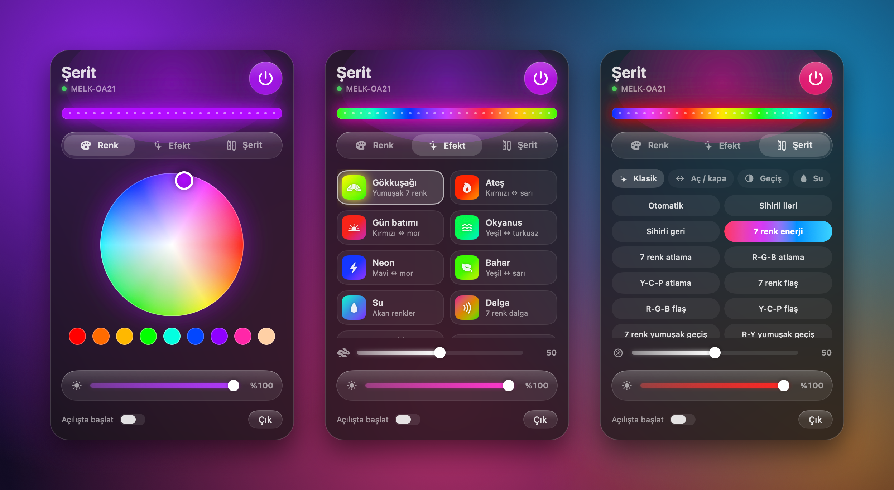

# Şerit

A macOS menu bar app for Bluetooth LED strips that use the **duoCo StripX** app (controllers that show up as `MELK-*`).

[Türkçe](#türkçe)



I didn't want to pick up my phone every time I changed the color of the strip on my desk, so I figured out the protocol and wrote this.

The UI is in Turkish (*şerit* means strip).

## Features

- Color wheel and presets
- 12 hand-picked effects plus all ~200 built-in modes of the controller, grouped
- Brightness and effect speed
- Auto-connects to the strip, reconnects when it drops
- Menu bar icon follows the strip color
- Launch at login

The animations run on the controller itself, so they are smooth. See [docs/PROTOCOL.md](docs/PROTOCOL.md) for why the app doesn't stream colors.

## Requirements

- macOS 26 (Tahoe) on Apple Silicon
- Xcode 26 or newer, only for building (tested with Xcode 27)

## Build

```sh
./build.sh
open ~/Applications/Şerit.app
```

On first launch macOS asks for Bluetooth permission. Close the duoCo app on your phone first; the controller only accepts one connection.

## Command line

`tools/stripx.py` does the same over the terminal (needs `pip install bleak`):

```sh
python3 tools/stripx.py renk FF0000     # color
python3 tools/stripx.py parlaklik 40     # brightness
python3 tools/stripx.py mod 199          # built-in mode
python3 tools/stripx.py kapat            # off (ac = on)
```

## Supported devices

Tested with a MELK-OA21. Other `MELK-*` controllers should work for color, power, brightness and modes. Scenes and the built-in microphone are not supported yet.

## License

MIT

## Türkçe

duoCo StripX uygulamasıyla çalışan Bluetooth LED şeritler (`MELK-*` diye görünen denetleyiciler) için macOS menü çubuğu uygulaması.

Masamdaki şeridin rengini değiştirmek için her seferinde telefona uzanmak istemedim. Protokolü çözüp bunu yazdım.

**Neler var:**

- Renk çarkı ve hazır renkler
- Seçilmiş 12 efekt ve şeridin kendi ~200 modu, gruplara ayrılmış halde
- Parlaklık ve efekt hızı
- Şeride kendiliğinden bağlanır, bağlantı koparsa tekrar bağlanır
- Menü çubuğundaki ikon şeridin rengini alır
- Mac açılınca başlayabilir

Efektler şeridin kendi çipinde dönüyor, o yüzden akıcı. Bilgisayardan renk akıtınca şerit titriyor, ayrıntısı [docs/PROTOCOL.md](docs/PROTOCOL.md)'de.

**Kurulum:** macOS 26 (Tahoe), Apple Silicon ve derlemek için Xcode 26 ya da üstü gerekli.

```sh
./build.sh
open ~/Applications/Şerit.app
```

İlk açılışta macOS Bluetooth izni ister. Telefondaki duoCo uygulamasını önce kapat, şerit aynı anda tek bağlantı kabul ediyor.

Terminalden kullanmak istersen `tools/stripx.py` var (`pip install bleak` gerekir): `renk FF0000`, `parlaklik 40`, `mod 199`, `ac`, `kapat`.

MELK-OA21 ile denendi. Diğer `MELK-*` denetleyicilerde renk, açma/kapama, parlaklık ve modların çalışması lazım; sahneler ve dahili mikrofon henüz yok.
